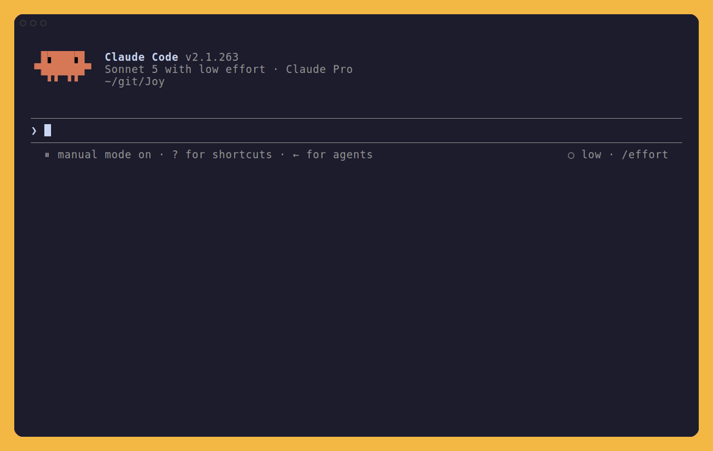
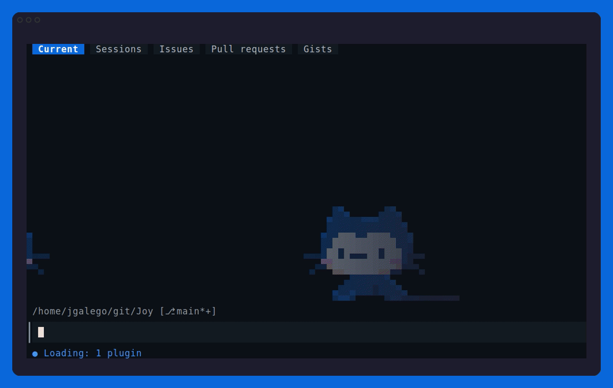

<div align="center">
	
	<h1>Joy</h1>
	<p><strong>Keep the joy. Let go of the toil.</strong></p>
	<p>
		<a href="https://code.claude.com/docs/en/overview"></a>
		<a href="https://docs.github.com/en/copilot/concepts/agents/copilot-cli/about-copilot-cli"></a>
		<a href="https://agentskills.io"></a>
	</p>
	<p>
		<a href="https://github.com/JGalego/Joy/actions/workflows/ci.yml"></a>
		<a href="LICENSE"></a>
	</p>
	<p><a href="https://jgalego.github.io/Joy/"><strong>Explore Joy →</strong></a></p>
	<p><strong>Install:</strong> <code>npx skills add JGalego/Joy --skill joy --agent claude-code --global --yes</code></p>
</div>

Joy is a KonMari-inspired Agent Skill for Claude Code and GitHub Copilot CLI. It helps you choose which parts of a programming task to keep, work through together, or delegate.

> **Which part do you want to remain yours?**

<p align="center">
	
</p>

## Demos

<details open>
<summary><strong>Claude Code</strong> — <code>pair</code> mode</summary>

<br>

<p align="center">
	<a href="https://jgalego.github.io/Joy/?demo=claude#demo"></a>
	<br>
	<a href="https://jgalego.github.io/Joy/?demo=claude#demo"><strong>Open the interactive recording →</strong></a>
</p>

</details>

<details open>
<summary><strong>GitHub Copilot CLI</strong> — <code>learn</code> mode</summary>

<br>

<p align="center">
	<a href="https://jgalego.github.io/Joy/?demo=copilot#demo"></a>
	<br>
	<a href="https://jgalego.github.io/Joy/?demo=copilot#demo"><strong>Open the interactive recording →</strong></a>
</p>

</details>

### Case study: webhook delivery

The [case study](https://jgalego.github.io/Joy/#case-study) records a read-only Claude Code review of a webhook worker. The developer keeps the delivery guarantee, retry policy, and claim transition; Joy helps examine the send-before-ack crash window and run tests.

The page includes chaptered playback, code excerpts, test results, and delivery trade-offs. Run the tests in [examples/webhook_worker](examples/webhook_worker) without third-party packages:

```sh
python3 -m unittest discover -s examples/webhook_worker/tests -v
```

## Install

### From skills.sh

Install [skills/joy](skills/joy) globally for Claude Code:

```sh
npx skills add JGalego/Joy --skill joy --agent claude-code --global --yes
```

### As a personal Claude Code skill

From a clone of this repository:

```sh
mkdir -p ~/.claude/skills
cp -R skills/joy ~/.claude/skills/joy
```

Restart Claude Code if the personal skills directory did not already exist. Invoke Joy as `/joy pair`.

### As a Claude Code plugin

Add the marketplace and install the plugin:

```text
/plugin marketplace add JGalego/Joy
/plugin install joy@joy
```

Invoke the installed plugin with:

```text
/joy:joy pair
```

Current Claude Code versions also accept the bare `/joy pair` alias unless another command already uses `joy`.

For local development, load the checkout directly:

```sh
claude --plugin-dir .
```

## Use

Joy can activate from requests about preserving authorship, learning without receiving the answer, pair programming, avoiding comprehension debt, deciding what to delegate, or tidying a repository.

### Modes

Personal skills use `/joy <mode>`:

| Mode | Behavior |
| --- | --- |
| `pair` | Work through the task together in small steps; the default |
| `learn` | Use hints and experiments without revealing the solution |
| `craft` | Keep architecture and core implementation with the user |
| `ship` | Delegate implementation and validation |
| `tidy` | Review what to **Keep**, **Refine**, or **Let go** |
| `off` | Return to normal assistant behavior |

Examples:

```text
/joy learn
Help me find this binary-search bug, but do not solve it for me.

/joy craft
Prepare tests for my cache, but leave the implementation empty.

/joy ship
Fix the failing authentication tests and validate the change.

/joy tidy
Review this repository and propose cleanup before deleting anything.

/joy off
```

A selected mode remains active in the current conversation until changed. “Just do it” switches the current task to `ship`. Explicit instructions always override inferred preferences.

## The ownership boundary

- **Keep** — the user owns the work.
- **Pair** — the user and AI work through it together.
- **Delegate** — the AI may execute it autonomously.

The boundary can change at any time. Joy asks at most one ownership question at the start of a substantial ambiguous task, never for trivial work, and not when the user already made the boundary clear.

Tidying uses a different decision: **Keep**, **Refine**, or **Let go**. Destructive tidying is proposed before it is applied unless autonomous cleanup was explicitly requested.

## Limitations

- Joy is prompt-guided behavior, not a deterministic policy engine. Review important output and generated code.
- It cannot know what a user enjoys; it can only preserve boundaries the user states or confirms.
- Mode and boundary state live in the current conversation, not across new sessions.
- Plugin invocations are namespaced when the bare `joy` alias conflicts.

## Development

The skill has no runtime dependencies or build step.

The [justfile](justfile) lists the available development tasks:

```sh
just               # list recipes
just check         # structural checks, plugin validation, skill discovery, and tests
just site          # preview at http://localhost:4173/
just run           # launch the local plugin
```

Run the dependency-free structural checks directly:

```sh
node scripts/validate.mjs
```

The full `just check` suite also requires Claude Code and `npx`. To run Claude Code's validators separately:

```sh
claude plugin validate . --strict
claude plugin validate ./skills --strict
```

CI runs the structural validator and the webhook-worker tests.

Before publishing changes to the skill or plugin metadata, bump the semantic version in [.claude-plugin/plugin.json](.claude-plugin/plugin.json); Claude Code uses that explicit version to decide whether an installed plugin should update.

### Recordings

The GIFs use [VHS](https://github.com/charmbracelet/vhs) with [assets/claude.tape](assets/claude.tape) and [assets/copilot.tape](assets/copilot.tape). The interactive casts use [scripts/record_cast.py](scripts/record_cast.py), which requires Python 3.9 or newer. Both record authenticated CLI sessions; re-recording consumes model quota and may change the wording.

```sh
just demo-claude     # Claude Code GIF
just demo-copilot    # Copilot CLI GIF
just cast           # all interactive recordings
just cast-case-study # webhook review only
```

The site plays the casts with [asciinema-player](https://github.com/asciinema/asciinema-player), with pause, seek, speed controls, and selectable text. Preview it with `just site`; [the Pages workflow](.github/workflows/pages.yml) publishes the same files.

### Behavioral evaluation

Load the plugin with `claude --plugin-dir .` and try the prompts in [skills/joy/evals/evals.json](skills/joy/evals/evals.json). Each case defines outcomes and assertions, not exact wording. Run each in fresh sessions with and without Joy, and record evidence for each assertion. Structural checks validate the fixtures, not the agent's behavior.

## Independence and trademarks

Joy is an independent open-source project. It is not affiliated with or endorsed by Marie Kondo or KonMari Media, Inc. “KonMari” is used only to describe the project's inspiration; no official logos, visual identity, or persona are used.

Joy is also independent of Anthropic. “Claude” and “Claude Code” are trademarks of Anthropic PBC. See the [MIT License](LICENSE) for this project's terms.
